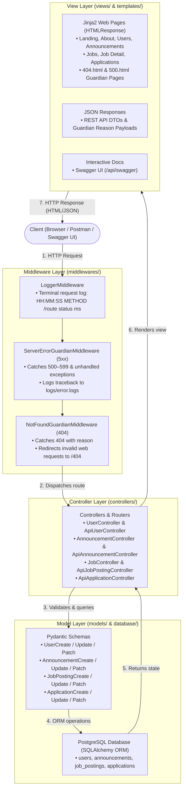

# Alumni Tracking System

This project is an **Alumni Tracking System** developed for the Web Programming course at Istanbul University.

> **Documentation:** [Data Design (`ddd.md`)](ddd.md) · [Brand Guidelines (`brand.md`)](brand.md) · [Design System (`design.md`)](design.md)

## Technology Stack

* **Backend:** FastAPI (Python)
* **API Documentation:** Swagger UI & OpenAPI (Automated)
* **Database:** PostgreSQL 16
* **ORM & Migrations:** SQLAlchemy & Alembic
* **Templating (View):** Jinja2 HTML Templates
* **Containerization:** Docker & Docker Compose

## MVC + Middleware Architecture

The application adopts the **Model-View-Controller (MVC)** architectural design pattern combined with a **Guardian & Logger Middleware** pipeline to ensure separation of concerns, observability, error resilience, and maintainability:



---

### 1. Model (M) — Data Representation, Validation & CRUD Logic

The **Model** layer encapsulates the data structures, validation rules, SQLAlchemy ORM persistence, and CRUD operations:

* **User Model (`models/user.py`):**
  * Backed by PostgreSQL (`users` table).
  * CRUD functions: `User.create`, `User.get_all`, `User.get_by_id`, `User.get_by_email`, `User.update`, `User.patch`, `User.delete`.
* **Announcement Model (`models/announcement.py`):**
  * Backed by PostgreSQL (`announcements` table).
  * CRUD functions: `Announcement.create`, `Announcement.get_all`, `Announcement.get_by_id`, `Announcement.update`, `Announcement.patch`, `Announcement.delete`.
* **JobPosting Model (`models/job_posting.py`):**
  * Backed by PostgreSQL (`job_postings` table, 1-N relationship with `users` via `posted_by`).
  * **Validation Rules (`JobPostingCreate`, `JobPostingUpdate`, `JobPostingPatch`):**
    * `title`: **Required**, max **120 characters** (`VARCHAR(120)`).
    * `company`: **Required** (`VARCHAR(150)`).
    * `city`: **Optional** (`VARCHAR(150)`, nullable).
    * `description`: **Optional** (`TEXT`, nullable).
    * `application_url`: **Optional** external application link (`VARCHAR(500)`, nullable).
* **Application Model (`models/application.py`):**
  * Backed by PostgreSQL (`applications` table, N-N relationship between `users` and `job_postings`).

### 2. View (V) — Presentation & Serialization

The **View** layer formats and presents data to clients and users:

* **HTML Views (`views/` & `views/templates/`):**
  * `users.html`, `announcements.html`, `announcement_detail.html`, `announcement_edit.html`, `jobs.html`, `job_detail.html`, `applications.html`.
  * `404.html`: Generic 404 Guardian error page matching the application's glassmorphism theme, displaying the error `reason`, `method`, and `path`.
  * `500.html`: 5xx Guardian server error page displaying the `status_code` and `reason`.
* **REST API JSON Views:**
  * Standardized JSON structures serialized from Python dictionaries and Pydantic schemas.
* **Interactive Documentation Views:**
  * **Swagger UI** (`/api/swagger`, `/docs`) and the **OpenAPI Schema** (`/openapi.json`).

### 3. Controller (C) — Request Handling & Application Logic

* **Web (HTML) Controllers:**
  * `UserController` (`/users`)
  * `AnnouncementController` (`/announcements`)
  * `JobController` (`/jobs`, `/applications`)
* **REST API (JSON) Controllers:**
  * `ApiUserController` (`/api/users`)
  * `ApiAnnouncementController` (`/api/announcements`)
  * `ApiJobPostingController` (`/api/job-postings` and `/api/users/{user_id}/job-postings`)
  * `ApiApplicationController` (`/api/applications`, `/api/users/{user_id}/applications`, `/api/job-postings/{job_id}/applications`)

---

## Middleware & Error Logging (`middlewares/` & `logs/error.logs`)

| Middleware / Module | File | Description |
| :--- | :--- | :--- |
| **LoggerMiddleware** | `middlewares/logger_middleware.py` | Logs every incoming HTTP request to the terminal in the format: `HH:MM:SS  METHOD /route status_code duration ms` (e.g. `10:20:30  POST /user 201 18 ms`). Also logs non-404 `4xx` errors to `logs/error.logs`. |
| **NotFoundGuardianMiddleware (404 Guardian)** | `middlewares/not_found_guardian_middleware.py` | Intercepts all `404 Not Found` responses, determines the exact `reason` (undefined route vs. missing database record), logs the error to `logs/error.logs`, redirects invalid web/browser requests (`302 Found`) to the generic `/404` page, and returns JSON with `reason` for `/api/...` requests. |
| **ServerErrorGuardianMiddleware (5xx Guardian)** | `middlewares/server_error_guardian_middleware.py` | Intercepts all `500–599` responses and unhandled runtime exceptions, writes the error reason and stack trace to `logs/error.logs` (instead of cluttering the terminal), and returns `500.html` (for browser requests) or a JSON error payload with `reason` (for `/api/...` requests). |
| **Error Logger** | `middlewares/error_logger.py` | Writes structured error entries and tracebacks to `logs/error.logs`. |

### Testing the Middlewares & Inspecting Logs

1. **Terminal Request Logs (`LoggerMiddleware`):**
   ```powershell
   docker compose logs -f web
   ```
   Example output:
   ```text
   alumni_web  | 06:57:55  GET /jobs 200 129 ms
   alumni_web  | 06:57:55  POST /api/job-postings 201 18 ms
   ```
2. **404 Guardian & Generic `/404` Redirect:**
   * Visit an invalid URL in your browser (e.g. [http://localhost:8000/gecersiz-sayfa](http://localhost:8000/gecersiz-sayfa) or [http://localhost:8000/jobs/999999](http://localhost:8000/jobs/999999)) — it automatically redirects to `/404?path=...&method=...&reason=...` and displays the styled 404 Guardian page.
   * Or test the JSON API: `curl.exe http://localhost:8000/api/users/999999`.
3. **5xx Guardian:**
   * Visit [http://localhost:8000/error-test](http://localhost:8000/error-test) in your browser to see the styled 500 Guardian page, or run `curl.exe http://localhost:8000/api/error-test` for the JSON response.
4. **Error Log File (`logs/error.logs`):**
   ```powershell
   Get-Content logs\error.logs
   ```

---

## Project Modular Directory Structure

```text
Alumni/
├── controllers/                             # Controller layer: HTML & REST API request handling
│   ├── __init__.py
│   ├── user_controller.py                   # /users (HTML CRUD)
│   ├── api_user_controller.py               # /api/users (JSON REST API)
│   ├── announcement_controller.py           # /announcements (HTML CRUD)
│   ├── api_announcement_controller.py       # /api/announcements (JSON REST API)
│   ├── job_controller.py                    # /jobs & /applications (HTML CRUD)
│   ├── api_job_posting_controller.py        # /api/job-postings & nested user routes
│   └── api_application_controller.py        # /api/applications & nested routes
├── middlewares/                             # Middleware layer: Logging & Error Guardians
│   ├── __init__.py
│   ├── logger_middleware.py                 # Terminal request logger (time method route status ms)
│   ├── not_found_guardian_middleware.py     # 404 Guardian (reason + redirect to /404)
│   ├── server_error_guardian_middleware.py  # 5xx Guardian (catches 500s & exceptions)
│   └── error_logger.py                      # Writes error details & tracebacks to logs/error.logs
├── models/                                  # Model layer: Pydantic schemas & SQLAlchemy CRUD
│   ├── __init__.py
│   ├── user.py
│   ├── announcement.py
│   ├── job_posting.py
│   └── application.py
├── database/                                # Database engine, session, ORM tables, factories & seed
│   ├── __init__.py
│   ├── session.py
│   ├── tables.py
│   ├── factories.py
│   └── seed.py
├── migrations/                              # Alembic schema migrations (0001 to 0004)
│   ├── env.py
│   └── versions/
│       ├── 0001_initial_schema.py
│       ├── 0002_create_job_postings.py
│       ├── 0003_create_applications.py
│       └── 0004_update_job_postings_rules.py
├── views/                                   # View layer: View classes & Jinja2 HTML templates
│   ├── __init__.py
│   ├── user_view.py
│   ├── announcement_view.py
│   ├── job_view.py
│   └── templates/
│       ├── _navbar.html
│       ├── announcement_base.html
│       ├── users.html
│       ├── announcements.html
│       ├── announcement_detail.html
│       ├── announcement_edit.html
│       ├── jobs.html
│       ├── job_detail.html
│       ├── applications.html
│       ├── 404.html
│       └── 500.html
├── logs/
│   └── error.logs                           # Persistent error & exception log file
├── ddd.md                                   # Data Design Documentation (ER Diagram & Table Rules)
├── alembic.ini
├── Dockerfile
├── docker-compose.yml
├── requirements.txt
├── main.py                                  # Application entrypoint, middleware & router registration
└── README.md
```

---

## Data Design ([ddd.md](ddd.md))

The relational database schema and validation rules are documented in **[ddd.md](ddd.md)** (Data Design Documentation):

| Table | Summary |
| :--- | :--- |
| `users` | `id`, `first_name`, `last_name`, `email` (unique, lowercase), `graduation_year`, `department` |
| `announcements` | `id`, `title`, `content`, `author`, `created_at` |
| `job_postings` | `id`, `title` (required, max 120 chars), `company` (required), `city` (optional), `employment_type`, `description` (optional), `application_url` (optional), `is_active`, `created_at`, `posted_by` (FK → `users.id`) |
| `applications` | `id`, `job_posting_id` (FK → `job_postings.id`), `user_id` (FK → `users.id`), `status`, `cover_letter`, `applied_at` |

See [ddd.md](ddd.md) for full constraints, indexes, relationships, and the Mermaid ER diagram.

---

## Brand Guidelines ([brand.md](brand.md))

The institutional brand identity for **İstanbul Üniversitesi — Yönetim Bilişim Sistemleri (İÜ YBS)**, including the *Bosphorus Night & Imperial Gold* color palette, tone of voice, and ready-to-use CSS variables, is documented in **[brand.md](brand.md)**.

---

## Design System ([design.md](design.md))

The complete `awesome-design-md`-style specification — color & typography tokens (`Plus Jakarta Sans`, `Inter`, `JetBrains Mono`), spacing/radius rules, GPU-composited motion/animation tokens, component specs, and AI agent prompt guide — is documented in **[design.md](design.md)**.

---

## Environment Variables

Secret configuration is stored in `.env` (ignored by Git via `.gitignore`), with [.env.example](.env.example) provided as a template:

```powershell
Copy-Item .env.example .env
```

| Variable | Description |
| :--- | :--- |
| `POSTGRES_USER` | PostgreSQL username |
| `POSTGRES_PASSWORD` | PostgreSQL password |
| `POSTGRES_DB` | Database name |

---

## Running the Project

Start the web application and PostgreSQL database with Docker Compose:

```powershell
docker compose up -d
docker compose exec web alembic upgrade head
```

Optionally seed the database with sample data:

```powershell
docker compose exec web python -m database.seed --reset --seed 42
```
