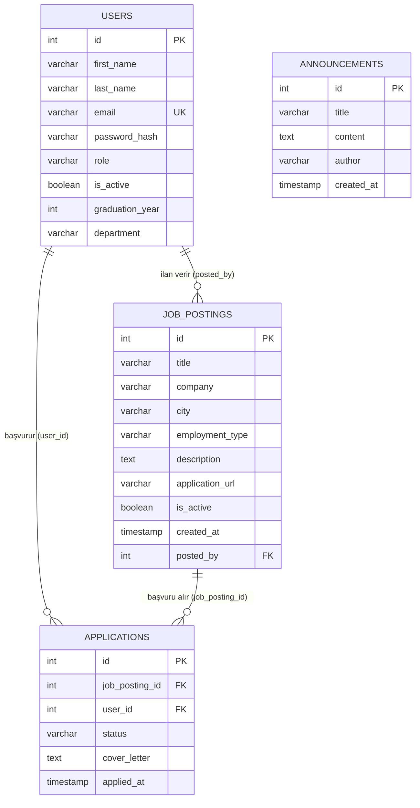
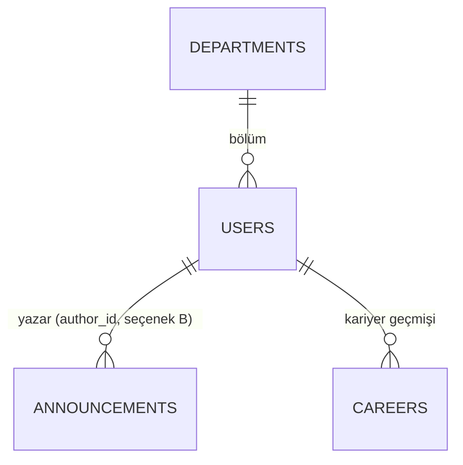

# Data Design Documentation (DDD)

> **Durum:** PostgreSQL + SQLAlchemy ORM + Alembic migration (`0001`–`0004`) altyapısı aktif olarak uygulanmıştır.
> Bu doküman, [README.md](README.md) içindeki ilişkisel veritabanı mimarisinin ve doğrulama kurallarının referans veri tasarımıdır.

## 1. Amaç ve Kapsam

Alumni Tracking System'in kalıcı veri modelini tanımlamak:

* Hangi varlıklar (entity) var, hangi alanları tutuyor?
* Alan tipleri, kısıtlar (constraint), indeksler ve doğrulama kuralları
* Varlıklar arası ilişkiler (1-N ve N-N)
* Mevcut Pydantic şemaları ve SQLAlchemy tabloları ile eşleşme

## 2. Teknoloji Kararları

| Konu | Karar |
| :--- | :--- |
| DBMS | PostgreSQL |
| ORM | SQLAlchemy |
| Birincil anahtar | `INTEGER` auto-increment (`SERIAL` / identity). Mevcut `_auto_increment_id` mantığıyla uyumlu |
| Zaman damgası | `TIMESTAMP` (UTC) |
| İsimlendirme | `snake_case`, tablo adları çoğul |

## 3. Varlıklar (Entities)

Mevcut kodda iki varlık vardır: **User** (mezun) ve **Announcement** (duyuru). Buna ek olarak tasarım aşamasında **JobPosting** (iş ilanı) ve **Application** (başvuru) tabloları tanımlanmıştır.

### 3.1 `users` tablosu

Kaynak: [models/user.py](models/user.py) (`UserCreate`, `UserUpdate`, `UserPatch`)

| Kolon | Tip | Kısıt | Açıklama |
| :--- | :--- | :--- | :--- |
| `id` | `INTEGER` | **PK**, auto-increment | Mezun / kullanıcı kimliği |
| `first_name` | `VARCHAR(100)` | `NOT NULL` | Ad |
| `last_name` | `VARCHAR(100)` | `NOT NULL` | Soyad |
| `email` | `VARCHAR(255)` | `NOT NULL`, **`UNIQUE`** | E-posta. Modelde `get_by_email` küçük harfe çevirip karşılaştırıyor, bu yüzden küçük harfle saklanmalı |
| `password_hash` | `VARCHAR(255)` | `NULL` olabilir | PBKDF2-HMAC-SHA256 ile hashlenmiş kullanıcı şifresi (`0005` migration) |
| `role` | `VARCHAR(20)` | `NOT NULL`, `DEFAULT 'alumni'`, `CHECK (role IN ('admin','staff','academic','student','alumni'))` | Kullanıcı rolü (`admin`: yönetici, `staff`: çalışan, `academic`: akademisyen, `student`: öğrenci, `alumni`: mezun) *(tasarım eklendi, sonraki migration)* |
| `is_active` | `BOOLEAN` | `NOT NULL`, `DEFAULT true` | Hesap aktif mi *(tasarım eklendi, sonraki migration)* |
| `graduation_year` | `INTEGER` | `NULL` olabilir, `CHECK (graduation_year BETWEEN 1900 AND 2100)` | Mezuniyet yılı (`student` ve `alumni` rolleri için zorunlu; `admin`, `staff` ve `academic` için opsiyonel) |
| `department` | `VARCHAR(150)` | `NOT NULL` | Bölüm / Birim |

**İndeksler**

| İndeks | Kolon | Neden |
| :--- | :--- | :--- |
| `pk_users` | `id` | Birincil anahtar |
| `uq_users_email` | `email` | Tekil e-posta, e-posta ile arama |
| `ix_users_role` | `role` | Role göre filtreleme ve yetkilendirme |
| `ix_users_department` | `department` | Bölüme göre filtreleme |
| `ix_users_graduation_year` | `graduation_year` | Yıla göre filtreleme |

### 3.2 `announcements` tablosu

Kaynak: [models/announcement.py](models/announcement.py)

| Kolon | Tip | Kısıt | Açıklama |
| :--- | :--- | :--- | :--- |
| `id` | `INTEGER` | **PK**, auto-increment | Duyuru kimliği |
| `title` | `VARCHAR(200)` | `NOT NULL` | Başlık |
| `content` | `TEXT` | `NOT NULL` | İçerik |
| `author` | `VARCHAR(150)` | `NOT NULL` | Yazar adı (serbest metin, bkz. 5. bölüm) |
| `created_at` | `TIMESTAMP` | `NOT NULL`, `DEFAULT now()` | Oluşturulma zamanı (kodda otomatik atanıyor) |

**İndeksler**

| İndeks | Kolon | Neden |
| :--- | :--- | :--- |
| `pk_announcements` | `id` | Birincil anahtar |
| `ix_announcements_created_at` | `created_at DESC` | En yeni duyuruları listeleme |

### 3.3 `job_postings` tablosu

Mezunlara yönelik iş ilanları. Kaynak: [models/job_posting.py](models/job_posting.py) (`JobPostingCreate`, `JobPostingUpdate`, `JobPostingPatch`).

**İş Kuralları (Validation Rules):**
* `title` (İlan başlığı): **Zorunlu** (`NOT NULL`), en fazla **120 karakter** (`VARCHAR(120)`).
* `company` (Şirket adı): **Zorunlu** (`NOT NULL`).
* `city` (Şehir / Konum): **İsteğe bağlı (opsiyonel)** (`NULL` olabilir).
* `description` (İlan açıklaması): **İsteğe bağlı (opsiyonel)** (`NULL` olabilir).
* `application_url` (Başvuru linki): **İsteğe bağlı (opsiyonel)** (`NULL` olabilir).

| Kolon | Tip | Kısıt | Açıklama |
| :--- | :--- | :--- | :--- |
| `id` | `INTEGER` | **PK**, auto-increment | İlan kimliği |
| `title` | `VARCHAR(120)` | `NOT NULL` | İlan başlığı — zorunlu, maks. 120 karakter (ör. "Backend Developer") |
| `company` | `VARCHAR(150)` | `NOT NULL` | Şirket adı — zorunlu (serbest metin) |
| `city` | `VARCHAR(150)` | `NULL` olabilir | Çalışma yeri / şehir — opsiyonel (şehir veya "Remote") |
| `employment_type` | `VARCHAR(30)` | `NOT NULL`, `DEFAULT 'full_time'`, `CHECK (employment_type IN ('full_time','part_time','internship','contract'))` | Çalışma türü |
| `description` | `TEXT` | `NULL` olabilir | İlan detayı — opsiyonel |
| `application_url` | `VARCHAR(500)` | `NULL` olabilir | Harici başvuru linki — opsiyonel |
| `is_active` | `BOOLEAN` | `NOT NULL`, `DEFAULT true` | İlan yayında mı |
| `created_at` | `TIMESTAMP` | `NOT NULL`, `DEFAULT now()` | Oluşturulma zamanı |
| `posted_by` | `INTEGER` | **FK** → `users.id`, `ON DELETE SET NULL`, `NULL` olabilir | İlanı veren mezun (opsiyonel) |

**İndeksler**

| İndeks | Kolon | Neden |
| :--- | :--- | :--- |
| `pk_job_postings` | `id` | Birincil anahtar |
| `ix_job_postings_created_at` | `created_at DESC` | En yeni ilanları listeleme |
| `ix_job_postings_company` | `company` | Şirkete göre filtreleme |
| `ix_job_postings_is_active` | `is_active` | Yalnızca aktif ilanları listeleme |
| `ix_job_postings_posted_by` | `posted_by` | FK, kullanıcının ilanlarını listeleme |

**İlişki:** `users` (1) → `job_postings` (N). Bir mezun birden çok ilan verebilir. Mezun silinirse ilanlar kalır, `posted_by` `NULL` olur. SQLAlchemy tarafında `UserTable.job_postings` ve `JobPostingTable.poster` çift yönlü `relationship` ile tanımlıdır.

> [!NOTE]
> Tablo adı, 2. bölümdeki "tablo adları çoğul" kuralı gereği `job_postings`'tir. İlan sahibi kararı için bkz. 5. bölüm, karar 6.

### 3.4 `applications` tablosu

Bir mezunun bir iş ilanına başvurusu. Kaynak: [models/application.py](models/application.py) (`ApplicationCreate`, `ApplicationUpdate`, `ApplicationPatch`).

| Kolon | Tip | Kısıt | Açıklama |
| :--- | :--- | :--- | :--- |
| `id` | `INTEGER` | **PK**, auto-increment | Başvuru kimliği |
| `job_posting_id` | `INTEGER` | `NOT NULL`, **FK** → `job_postings.id`, `ON DELETE CASCADE` | Başvurulan ilan |
| `user_id` | `INTEGER` | `NOT NULL`, **FK** → `users.id`, `ON DELETE CASCADE` | Başvuran mezun |
| `status` | `VARCHAR(20)` | `NOT NULL`, `DEFAULT 'pending'`, `CHECK (status IN ('pending','reviewed','accepted','rejected'))` | Başvuru durumu |
| `cover_letter` | `TEXT` | `NULL` olabilir | Ön yazı |
| `applied_at` | `TIMESTAMP` | `NOT NULL`, `DEFAULT now()` | Başvuru zamanı |

Ek kısıt: `UNIQUE (job_posting_id, user_id)` (`uq_applications_job_user`). Bir mezun aynı ilana yalnızca bir kez başvurabilir.

**İndeksler**

| İndeks | Kolon | Neden |
| :--- | :--- | :--- |
| `pk_applications` | `id` | Birincil anahtar |
| `uq_applications_job_user` | `job_posting_id, user_id` | Tekrar başvuruyu engelleme, ilana göre arama |
| `ix_applications_user_id` | `user_id` | Mezunun başvurularını listeleme |
| `ix_applications_status` | `status` | Duruma göre filtreleme |

**İlişkiler**
* `users` (1) → `applications` (N): bir mezun birden çok ilana başvurabilir.
* `job_postings` (1) → `applications` (N): bir ilan birden çok başvuru alabilir.
* Böylece `users` ↔ `job_postings` arasında `applications` üzerinden **N-N** ilişki kurulur.
* Silme: mezun veya ilan silinirse başvurular da silinir (`CASCADE`). Bkz. 5. bölüm, karar 7.
* SQLAlchemy tarafında `UserTable.applications`, `JobPostingTable.applications` ve `ApplicationTable.user` / `ApplicationTable.job_posting` çift yönlü `relationship` ile tanımlıdır.

## 4. ER Diyagramı

`users` ile `job_postings` arasında **1-N ilişki** vardır (`job_postings.posted_by` → `users.id`, `ON DELETE SET NULL`). `applications` tablosu, `users` ile `job_postings` arasındaki **N-N ilişkiyi** iki adet 1-N ilişkiye böler (bkz. 3.4). `announcements` ile hâlâ ilişki yoktur, gerekçe 5. bölümde.

## 5. İlişkiler ve Açık Tasarım Kararları

| # | Konu | Mevcut durum | Seçenek | Öneri |
| :--- | :--- | :--- | :--- | :--- |
| 1 | `announcements.author` | Serbest metin | **A)** Metin olarak kalsın. **B)** `author_id` ile `users.id` FK olsun | **A** ile başla. Mevcut API ve formlar `author` metni alıyor. Yazar mezun olmayabilir (ör. yönetici) |
| 2 | Kullanıcı rolleri | `role` (`admin`, `staff`, `academic`, `student`, `alumni`) + `is_active` tasarlandı | **A)** `users.role` kolonu (`CHECK` kısıtı ile). **B)** Ayrı `roles` tablosu | **A** seçildi (bkz. 6. bölüm). Sonraki migration ile uygulanacak |
| 3 | Mezun kariyer bilgisi | Yok (README amaç olarak belirtiyor) | `careers` tablosu (şirket, pozisyon, tarih), `users` ile 1-N | Sonraki aşama için aday |
| 4 | `department` | Serbest metin | Ayrı `departments` tablosu ve FK | Tutarlılık için ileride düşünülebilir. Şimdilik metin |
| 5 | Silme davranışı | Kayıt silinir | Soft delete (`deleted_at`) | Şimdilik hard delete (mevcut `delete` davranışı) |
| 6 | `job_postings` ilan sahibi | `posted_by` → `users.id` FK (seçenek B) | **A)** Sahip tutulmasın. **B)** `posted_by` FK (`ON DELETE SET NULL`) | **B** uygulandı. Alan opsiyonel olduğu için yönetici ilanları da girilebilir |
| 7 | `applications` silme davranışı | `user_id` ve `job_posting_id` FK, `ON DELETE CASCADE` | **A)** `CASCADE`. **B)** `SET NULL` (başvuru kalsın) | **A** uygulandı. Başvuru, mezun ve ilan olmadan anlamsızdır |
| 8 | Aynı ilana tekrar başvuru | `UNIQUE (job_posting_id, user_id)` | **A)** Tek başvuru. **B)** Birden çok başvuruya izin | **A** uygulandı |

> [!NOTE]
> 1, 3 ve 4 numaralı kararlar hocayla netleştirilecek. Seçenek B veya ayrı tablolar seçilirse ER diyagramı güncellenecek.

### Olası genişletilmiş model (henüz uygulanmayacak)

## 6. Kullanıcı Rolleri ve Erişim Kuralları (Yetkilendirme)

Sistemde tüm korumalı modüller yalnızca oturum açmış (kayıtlı) kullanıcılar içindir; `guest` (girişsiz) erişim rolü bulunmaz.

### 6.1 Sistem Rolleri (`users.role`)

| Rol | Açıklama |
| :--- | :--- |
| `admin` | **Yönetici:** Sistemin tamamına tam yetkili. Kullanıcı yönetimi (ekleme, listeleme, silme, rol atama) yalnızca bu role aittir. |
| `staff` | **Çalışan:** İdari veya kariyer merkezi personeli. Duyuru ve iş ilanı yönetebilir, tüm başvuruları inceleyip durumlarını güncelleyebilir. |
| `academic` | **Akademisyen:** Öğretim üyesi / akademik personel. Akademik duyuru ve ilan (ör. araştırma/staj/asistanlık) paylaşabilir, kendi açtığı ilanlara gelen başvuruları değerlendirebilir. |
| `alumni` | **Mezun:** Duyuruları ve aktif iş ilanlarını görüntüler, iş ilanı açabilir, ilanlara başvurabilir ve kendi açtığı ilanlara gelen başvuruları yönetebilir. |
| `student` | **Öğrenci:** Duyuruları ve aktif iş ilanlarını görüntüler, ilanlara başvurabilir ve kendi başvurularını takip edebilir. |

### 6.2 Modül Bazlı Erişim Matrisi

| Modül / Rotalar | `student` (Öğrenci) | `alumni` (Mezun) | `academic` (Akademisyen) | `staff` (Çalışan) | `admin` (Yönetici) |
| :--- | :--- | :--- | :--- | :--- | :--- |
| **Ana Sayfa & Sistem** (`/`, `/about`, `/api/health`) | Görüntüleme | Görüntüleme | Görüntüleme | Görüntüleme | Görüntüleme |
| **Duyurular** (`/announcements`, `/api/announcements`) | Görüntüleme | Görüntüleme | Görüntüleme + Oluşturma *(kendi duyurusunu düzenleme/silme)* | Oluşturma / Düzenleme / Silme | Tam yetki (Oluşturma / Düzenleme / Silme) |
| **İş İlanları** (`/jobs`, `/api/job-postings`) | Aktif ilanları görüntüleme | Aktif ilanları görüntüleme + İlan oluşturma + **Kendi** ilanını düzenleme/silme | Aktif ilanları görüntüleme + İlan oluşturma + **Kendi** ilanını düzenleme/silme | İlan oluşturma + İlanları düzenleme / pasife alma / silme | Tam yetki (Pasif ilanlar dahil tümünü görme, düzenleme, silme) |
| **Başvurular** (`/applications`, `/jobs/{id}/apply`, `/api/applications`) | İlanlara başvurma + **Kendi** başvurularını görme / silme | İlanlara başvurma + **Kendi** başvurularını görme / silme + **Kendi ilanına** gelen başvuruları görme ve durumunu güncelleme | **Kendi ilanına** gelen başvuruları görme ve durumunu (`pending` → `reviewed` / `accepted` / `rejected`) güncelleme | Tüm başvuruları görme + Başvuru durumunu (`pending` → `reviewed` / `accepted` / `rejected`) güncelleme | Tam yetki (Tümünü görme, durum güncelleme, silme) |
| **Kullanıcı Yönetimi** (`/users`, `/api/users`) | Erişim yok *(yalnızca kendi profilini görüntüleme / güncelleme)* | Erişim yok *(yalnızca kendi profilini görüntüleme / güncelleme)* | Erişim yok *(yalnızca kendi profilini görüntüleme / güncelleme)* | Erişim yok *(yalnızca kendi profilini görüntüleme / güncelleme)* | **Tam yetki** (Kullanıcı listeleme, ekleme, düzenleme, silme, rol ve `is_active` atama) |

### 6.3 Kullanıcı ve Sahiplik İş Kuralları

1. **Kullanıcı Yönetimi Kısıtı:** Kullanıcı listeleme, yeni kullanıcı ekleme, kullanıcı silme, `role` değiştirme ve `is_active` güncelleme işlemleri **yalnızca `admin`** tarafından yapılabilir. `student`, `alumni`, `academic` ve `staff` kendi profil bilgilerini (`first_name`, `last_name`, `email`, `department`, `graduation_year`) güncelleyebilir ancak `role` ve `is_active` alanlarını değiştiremez.
2. **Mezuniyet Yılı Zorunluluğu:** `role` değeri `student` veya `alumni` olan kullanıcılarda `graduation_year` zorunludur (öğrenciler için beklenen mezuniyet yılı). `admin`, `staff` ve `academic` rollerinde `graduation_year` `NULL` olabilir.
3. **Pasif Hesap (`is_active = false`):** Pasife alınmış kullanıcılar sisteme giriş yapamaz ve işlem gerçekleştiremez.
4. **İlan Sahipliği (Ownership):** `alumni` ve `academic` yalnızca kendi oluşturduğu iş ilanını (`job_postings.posted_by == current_user.id`) düzenleyebilir veya silebilir.
5. **Başvuru Sahipliği:** `student` ve `alumni` yalnızca kendi yaptığı başvuruyu (`applications.user_id == current_user.id`) görüntüleyebilir veya geri çekebilir (`DELETE`).
6. **Kendi İlanına Başvuru Engeli:** `alumni` kendi oluşturduğu iş ilanına başvuramaz (`job_posting.posted_by != current_user.id`).

## 7. Pydantic Şeması ve Tablo Eşleşmesi

| Pydantic şeması | Tablo | Not |
| :--- | :--- | :--- |
| `UserCreate` | `users` | `id` gönderilmez, DB üretir; `role` ve `is_active` yalnızca `admin` tarafından atanabilir (varsayılan `alumni`, `true`) |
| `UserUpdate` (PUT) | `users` | Tüm zorunlu alanlar (`graduation_year` `student`/`alumni` için zorunlu); `role`/`is_active` yalnızca `admin` |
| `UserPatch` (PATCH) | `users` | Tüm alanlar opsiyonel; `role`/`is_active` yalnızca `admin` tarafından güncellenebilir |
| `AnnouncementCreate` | `announcements` | `id` ve `created_at` DB/uygulama üretir |
| `AnnouncementUpdate` (PUT) | `announcements` | `created_at` değişmez |
| `AnnouncementPatch` (PATCH) | `announcements` | Tüm alanlar opsiyonel |
| `JobPostingCreate` | `job_postings` | `title` (zorunlu, maks. 120 kr.) ve `company` (zorunlu); `city`, `description`, `application_url` opsiyonel |
| `JobPostingUpdate` (PUT) | `job_postings` | `title` (maks. 120 kr.) ve `company` zorunlu; `city`, `description`, `application_url` opsiyonel |
| `JobPostingPatch` (PATCH) | `job_postings` | Tüm alanlar opsiyonel (`title` gönderilirse maks. 120 kr.) |
| `ApplicationCreate` | `applications` | `id` ve `applied_at` DB üretir, `status` varsayılan `pending` |
| `ApplicationUpdate` (PUT) | `applications` | `job_posting_id`, `user_id` ve `applied_at` değişmez |
| `ApplicationPatch` (PATCH) | `applications` | Yalnızca `status` ve `cover_letter`, opsiyonel |

## 8. CRUD'un SQL Karşılığı (Taslak)

| İşlem | Mevcut model fonksiyonu | SQL |
| :--- | :--- | :--- |
| Create | `User.create` | `INSERT INTO users (...) VALUES (...) RETURNING *` |
| Read all | `User.get_all` | `SELECT * FROM users` |
| Read by id | `User.get_by_id` | `SELECT * FROM users WHERE id = :id` |
| Read by email | `User.get_by_email` | `SELECT * FROM users WHERE email = lower(:email)` |
| Update (PUT) | `User.update` | `UPDATE users SET ... WHERE id = :id` |
| Patch | `User.patch` | `UPDATE users SET <yalnızca gelen alanlar> WHERE id = :id` |
| Delete | `User.delete` | `DELETE FROM users WHERE id = :id` |

`announcements`, `job_postings` ve `applications` için aynı kalıp geçerlidir. Bulunamayan `id` için `None` döner, controller bunu **404**'e çevirir.

## 9. Kalıcılık ve Migration Geçmişi

* `docker-compose.yml` içinde `db` (`postgres:16-alpine`) servisi ve `postgres_data` **named volume** tanımlıdır.
* Alembic migration dosyaları (`migrations/versions/`):
  * `0001_initial_schema.py`: `users` ve `announcements` tabloları.
  * `0002_create_job_postings.py`: `job_postings` tablosu ve `users` (1-N) ilişkisi.
  * `0003_create_applications.py`: `applications` tablosu ve N-N ilişkisi.
  * `0004_update_job_postings_rules.py`: `JobPosting` kuralları (`title` maks. 120 karakter, `city` ve `description` opsiyonel, `application_url` opsiyonel başvuru linki eklendi).
  * `0005_add_user_password_hash.py`: `users.password_hash` kolonu eklendi (kayıt ve girişte şifre doğrulama için).
  * `0006_add_user_role_and_is_active.py`: `users.role` (`admin`, `staff`, `academic`, `student`, `alumni`), `users.is_active` ve `graduation_year` opsiyonel kuralı eklendi.

## 10. Tamamlanan ve Planlanan Adımlar

- [x] ER diyagramını `users`, `announcements`, `job_postings` ve `applications` ile güncelle
- [x] Veritabanını ve Alembic migration altyapısını oluştur (`0001`–`0006`)
- [x] Modelleri SQLAlchemy'ye taşı
- [x] `JobPosting` alan kurallarını (`title` maks. 120, `company` zorunlu, `city`, `description`, `application_url` opsiyonel) uygula
- [x] Unutma testini ve seeder (`database/seed.py`) yapısını doğrula
- [x] Kayıt (`/register`) ve Giriş/Çıkış (`/login`, `/logout`) akışında şifre hashleme ve doğrulama (`password_hash`, `0005`) eklendi
- [x] `users.role` (`admin`, `staff`, `academic`, `student`, `alumni`), `users.is_active` (`0006`) ve **Admin Paneli** (`/admin`) uygulandı
- [ ] **Üniversite Üyelik & Hibrit E-posta Onay Servis Katmanı (Şimdilik Pasif):** Öğrenci/akademisyen/mezun doğrulaması (`services/auth_service.py`: `@ogr.iu.edu.tr` / `@istanbul.edu.tr` için otomatik `is_active=True`, kişisel e-postalar için `is_active=False` admin onay kuyruğu ve `role` kaydı) henüz aktif değildir; sonraki aşamada eklenecektir.
