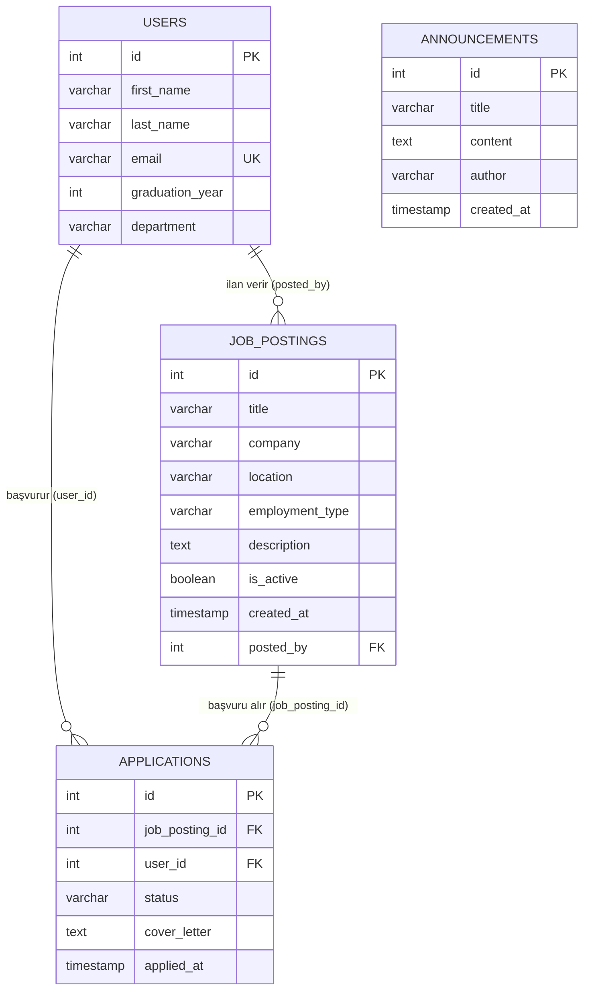
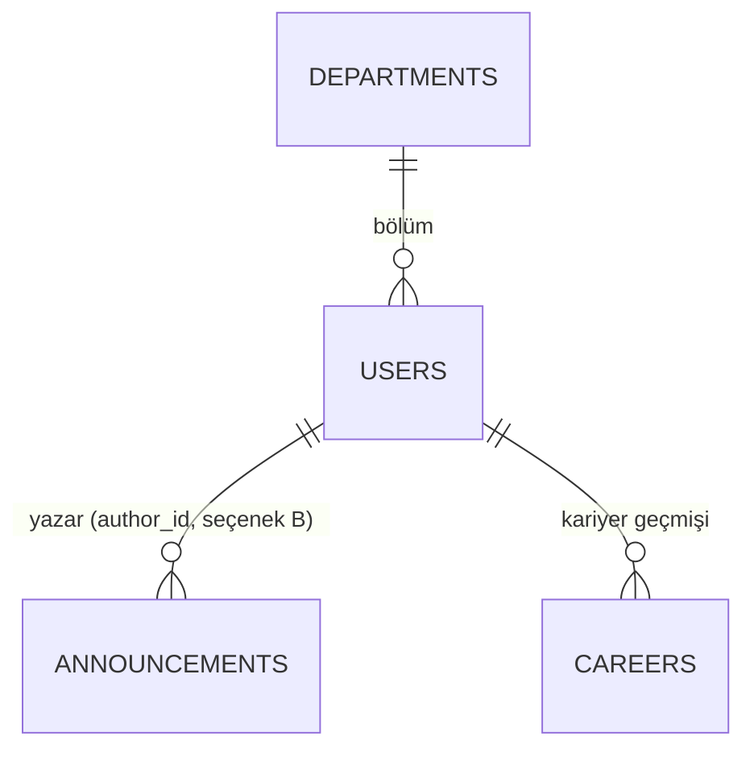

# Data Design Documentation (DDD)

> **Durum:** Yalnızca tasarım aşaması. Veritabanı **henüz oluşturulmamıştır**; uygulama hâlâ bellek içi (`_db`) depolama kullanır.
> Bu doküman, [README.md](README.md) içindeki "Planned" PostgreSQL + SQLAlchemy geçişinin veri tasarımıdır.

## 1. Amaç ve Kapsam

Alumni Tracking System'in kalıcı veri modelini tanımlamak:

* Hangi varlıklar (entity) var, hangi alanları tutuyor?
* Alan tipleri, kısıtlar (constraint), indeksler
* Varlıklar arası ilişkiler
* Mevcut Pydantic şemaları ile eşleşme

**Neden gerekli?** Mevcut veri `User._db` ve `Announcement._db` listelerinde tutuluyor. Konteyner yeniden başlayınca veri kayboluyor (unutma testi başarısız oldu). Kalıcılık için ilişkisel veritabanı tasarımı gerekiyor.

## 2. Teknoloji Kararları

| Konu | Karar |
| :--- | :--- |
| DBMS | PostgreSQL |
| ORM | SQLAlchemy |
| Birincil anahtar | `INTEGER` auto-increment (`SERIAL` / identity). Mevcut `_auto_increment_id` mantığıyla uyumlu |
| Zaman damgası | `TIMESTAMP` (UTC) |
| İsimlendirme | `snake_case`, tablo adları çoğul |

## 3. Varlıklar (Entities)

Mevcut kodda iki varlık vardır: **User** (mezun) ve **Announcement** (duyuru). Buna ek olarak tasarım aşamasında **JobPosting** (iş ilanı) ve **Application** (başvuru) tabloları tanımlanmıştır.

### 3.1 `users` tablosu

Kaynak: [models/user.py](models/user.py) (`UserCreate`, `UserUpdate`, `UserPatch`)

| Kolon | Tip | Kısıt | Açıklama |
| :--- | :--- | :--- | :--- |
| `id` | `INTEGER` | **PK**, auto-increment | Mezun kimliği |
| `first_name` | `VARCHAR(100)` | `NOT NULL` | Ad |
| `last_name` | `VARCHAR(100)` | `NOT NULL` | Soyad |
| `email` | `VARCHAR(255)` | `NOT NULL`, **`UNIQUE`** | E-posta. Modelde `get_by_email` küçük harfe çevirip karşılaştırıyor, bu yüzden küçük harfle saklanmalı |
| `graduation_year` | `INTEGER` | `NOT NULL`, `CHECK (graduation_year BETWEEN 1900 AND 2100)` | Mezuniyet yılı |
| `department` | `VARCHAR(150)` | `NOT NULL` | Bölüm |

**İndeksler**

| İndeks | Kolon | Neden |
| :--- | :--- | :--- |
| `pk_users` | `id` | Birincil anahtar |
| `uq_users_email` | `email` | Tekil e-posta, e-posta ile arama |
| `ix_users_department` | `department` | Bölüme göre filtreleme |
| `ix_users_graduation_year` | `graduation_year` | Yıla göre filtreleme |

### 3.2 `announcements` tablosu

Kaynak: [models/announcement.py](models/announcement.py)

| Kolon | Tip | Kısıt | Açıklama |
| :--- | :--- | :--- | :--- |
| `id` | `INTEGER` | **PK**, auto-increment | Duyuru kimliği |
| `title` | `VARCHAR(200)` | `NOT NULL` | Başlık |
| `content` | `TEXT` | `NOT NULL` | İçerik |
| `author` | `VARCHAR(150)` | `NOT NULL` | Yazar adı (serbest metin, bkz. 5. bölüm) |
| `created_at` | `TIMESTAMP` | `NOT NULL`, `DEFAULT now()` | Oluşturulma zamanı (kodda otomatik atanıyor) |

**İndeksler**

| İndeks | Kolon | Neden |
| :--- | :--- | :--- |
| `pk_announcements` | `id` | Birincil anahtar |
| `ix_announcements_created_at` | `created_at DESC` | En yeni duyuruları listeleme |

### 3.3 `job_postings` tablosu

Mezunlara yönelik iş ilanları. Kaynak: [models/job_posting.py](models/job_posting.py) (`JobPostingCreate`, `JobPostingUpdate`, `JobPostingPatch`).

| Kolon | Tip | Kısıt | Açıklama |
| :--- | :--- | :--- | :--- |
| `id` | `INTEGER` | **PK**, auto-increment | İlan kimliği |
| `title` | `VARCHAR(200)` | `NOT NULL` | İlan başlığı (ör. "Backend Developer") |
| `company` | `VARCHAR(150)` | `NOT NULL` | Şirket adı (serbest metin) |
| `location` | `VARCHAR(150)` | `NOT NULL` | Çalışma yeri (şehir veya "Remote") |
| `employment_type` | `VARCHAR(30)` | `NOT NULL`, `DEFAULT 'full_time'`, `CHECK (employment_type IN ('full_time','part_time','internship','contract'))` | Çalışma türü |
| `description` | `TEXT` | `NOT NULL` | İlan detayı |
| `is_active` | `BOOLEAN` | `NOT NULL`, `DEFAULT true` | İlan yayında mı |
| `created_at` | `TIMESTAMP` | `NOT NULL`, `DEFAULT now()` | Oluşturulma zamanı |
| `posted_by` | `INTEGER` | **FK** → `users.id`, `ON DELETE SET NULL`, `NULL` olabilir | İlanı veren mezun (opsiyonel) |

**İndeksler**

| İndeks | Kolon | Neden |
| :--- | :--- | :--- |
| `pk_job_postings` | `id` | Birincil anahtar |
| `ix_job_postings_created_at` | `created_at DESC` | En yeni ilanları listeleme |
| `ix_job_postings_company` | `company` | Şirkete göre filtreleme |
| `ix_job_postings_is_active` | `is_active` | Yalnızca aktif ilanları listeleme |
| `ix_job_postings_posted_by` | `posted_by` | FK, kullanıcının ilanlarını listeleme |

**İlişki:** `users` (1) → `job_postings` (N). Bir mezun birden çok ilan verebilir. Mezun silinirse ilanlar kalır, `posted_by` `NULL` olur. SQLAlchemy tarafında `UserTable.job_postings` ve `JobPostingTable.poster` çift yönlü `relationship` ile tanımlıdır.

> [!NOTE]
> Tablo adı, 2. bölümdeki "tablo adları çoğul" kuralı gereği `job_postings`'tir. İlan sahibi kararı için bkz. 5. bölüm, karar 6.

### 3.4 `applications` tablosu

Bir mezunun bir iş ilanına başvurusu. Kaynak: [models/application.py](models/application.py) (`ApplicationCreate`, `ApplicationUpdate`, `ApplicationPatch`).

| Kolon | Tip | Kısıt | Açıklama |
| :--- | :--- | :--- | :--- |
| `id` | `INTEGER` | **PK**, auto-increment | Başvuru kimliği |
| `job_posting_id` | `INTEGER` | `NOT NULL`, **FK** → `job_postings.id`, `ON DELETE CASCADE` | Başvurulan ilan |
| `user_id` | `INTEGER` | `NOT NULL`, **FK** → `users.id`, `ON DELETE CASCADE` | Başvuran mezun |
| `status` | `VARCHAR(20)` | `NOT NULL`, `DEFAULT 'pending'`, `CHECK (status IN ('pending','reviewed','accepted','rejected'))` | Başvuru durumu |
| `cover_letter` | `TEXT` | `NULL` olabilir | Ön yazı |
| `applied_at` | `TIMESTAMP` | `NOT NULL`, `DEFAULT now()` | Başvuru zamanı |

Ek kısıt: `UNIQUE (job_posting_id, user_id)` (`uq_applications_job_user`). Bir mezun aynı ilana yalnızca bir kez başvurabilir.

**İndeksler**

| İndeks | Kolon | Neden |
| :--- | :--- | :--- |
| `pk_applications` | `id` | Birincil anahtar |
| `uq_applications_job_user` | `job_posting_id, user_id` | Tekrar başvuruyu engelleme, ilana göre arama |
| `ix_applications_user_id` | `user_id` | Mezunun başvurularını listeleme |
| `ix_applications_status` | `status` | Duruma göre filtreleme |

**İlişkiler**
* `users` (1) → `applications` (N): bir mezun birden çok ilana başvurabilir.
* `job_postings` (1) → `applications` (N): bir ilan birden çok başvuru alabilir.
* Böylece `users` ↔ `job_postings` arasında `applications` üzerinden **N-N** ilişki kurulur.
* Silme: mezun veya ilan silinirse başvurular da silinir (`CASCADE`). Bkz. 5. bölüm, karar 7.
* SQLAlchemy tarafında `UserTable.applications`, `JobPostingTable.applications` ve `ApplicationTable.user` / `ApplicationTable.job_posting` çift yönlü `relationship` ile tanımlıdır.

## 4. ER Diyagramı

`users` ile `job_postings` arasında **1-N ilişki** vardır (`job_postings.posted_by` → `users.id`, `ON DELETE SET NULL`). `applications` tablosu, `users` ile `job_postings` arasındaki **N-N ilişkiyi** iki adet 1-N ilişkiye böler (bkz. 3.4). `announcements` ile hâlâ ilişki yoktur, gerekçe 5. bölümde.

## 5. İlişkiler ve Açık Tasarım Kararları

| # | Konu | Mevcut durum | Seçenek | Öneri |
| :--- | :--- | :--- | :--- | :--- |
| 1 | `announcements.author` | Serbest metin | **A)** Metin olarak kalsın. **B)** `author_id` ile `users.id` FK olsun | **A** ile başla. Mevcut API ve formlar `author` metni alıyor. Yazar mezun olmayabilir (ör. yönetici) |
| 2 | Kullanıcı rolleri (admin/mezun) | Yok | `role` kolonu veya ayrı `roles` tablosu | Kapsam dışı. Gerekirse sonra eklenir |
| 3 | Mezun kariyer bilgisi | Yok (README amaç olarak belirtiyor) | `careers` tablosu (şirket, pozisyon, tarih), `users` ile 1-N | Sonraki aşama için aday |
| 4 | `department` | Serbest metin | Ayrı `departments` tablosu ve FK | Tutarlılık için ileride düşünülebilir. Şimdilik metin |
| 5 | Silme davranışı | Kayıt silinir | Soft delete (`deleted_at`) | Şimdilik hard delete (mevcut `delete` davranışı) |
| 6 | `job_postings` ilan sahibi | `posted_by` → `users.id` FK (seçenek B) | **A)** Sahip tutulmasın. **B)** `posted_by` FK (`ON DELETE SET NULL`) | **B** uygulandı. Alan opsiyonel olduğu için yönetici ilanları da girilebilir |
| 7 | `applications` silme davranışı | `user_id` ve `job_posting_id` FK, `ON DELETE CASCADE` | **A)** `CASCADE`. **B)** `SET NULL` (başvuru kalsın) | **A** uygulandı. Başvuru, mezun ve ilan olmadan anlamsızdır |
| 8 | Aynı ilana tekrar başvuru | `UNIQUE (job_posting_id, user_id)` | **A)** Tek başvuru. **B)** Birden çok başvuruya izin | **A** uygulandı |

> [!NOTE]
> 1, 3 ve 4 numaralı kararlar hocayla netleştirilecek. Seçenek B veya ayrı tablolar seçilirse ER diyagramı güncellenecek.

### Olası genişletilmiş model (henüz uygulanmayacak)

## 6. Pydantic Şeması ve Tablo Eşleşmesi

| Pydantic şeması | Tablo | Not |
| :--- | :--- | :--- |
| `UserCreate` | `users` | `id` gönderilmez, DB üretir |
| `UserUpdate` (PUT) | `users` | Tüm alanlar zorunlu |
| `UserPatch` (PATCH) | `users` | Tüm alanlar opsiyonel |
| `AnnouncementCreate` | `announcements` | `id` ve `created_at` DB/uygulama üretir |
| `AnnouncementUpdate` (PUT) | `announcements` | `created_at` değişmez |
| `AnnouncementPatch` (PATCH) | `announcements` | Tüm alanlar opsiyonel |
| `JobPostingCreate` | `job_postings` | `id` ve `created_at` DB üretir |
| `ApplicationCreate` | `applications` | `id` ve `applied_at` DB üretir, `status` varsayılan `pending` |
| `ApplicationUpdate` (PUT) | `applications` | `job_posting_id`, `user_id` ve `applied_at` değişmez |
| `ApplicationPatch` (PATCH) | `applications` | Yalnızca `status` ve `cover_letter`, opsiyonel |

## 7. CRUD'un SQL Karşılığı (Taslak)

| İşlem | Mevcut model fonksiyonu | SQL |
| :--- | :--- | :--- |
| Create | `User.create` | `INSERT INTO users (...) VALUES (...) RETURNING *` |
| Read all | `User.get_all` | `SELECT * FROM users` |
| Read by id | `User.get_by_id` | `SELECT * FROM users WHERE id = :id` |
| Read by email | `User.get_by_email` | `SELECT * FROM users WHERE email = lower(:email)` |
| Update (PUT) | `User.update` | `UPDATE users SET ... WHERE id = :id` |
| Patch | `User.patch` | `UPDATE users SET <yalnızca gelen alanlar> WHERE id = :id` |
| Delete | `User.delete` | `DELETE FROM users WHERE id = :id` |

`announcements` için aynı kalıp geçerlidir. Bulunamayan `id` için `0 satır` etkilenir, controller bunu **404**'e çevirir (mevcut davranış).

## 8. Kalıcılık Planı (Uygulama aşaması için not)

Şimdilik **uygulanmayacak**, sadece planlanıyor:

* `docker-compose.yml` içine `db` (PostgreSQL) servisi ve **named volume** eklenecek. Amaç: "unutma testinin" geçmesi.
* `requirements.txt` içine `sqlalchemy` ve bir PostgreSQL sürücüsü eklenecek.
* Model katmanı bellek içi `_db` yerine SQLAlchemy oturumu kullanacak. Controller'lar aynı kalacak.
* Doğrulama: kayıt oluştur, `docker compose down` ve `up`, kaydı kontrol et.

## 9. Sonraki Adımlar

- [ ] Açık tasarım kararlarını (5. bölüm) hocayla netleştir
- [ ] ER diyagramını son haline getir
- [ ] Veritabanını oluştur (**bu aşamada yapılmıyor**)
- [ ] Modelleri SQLAlchemy'ye taşı
- [ ] Unutma testini tekrar çalıştır
