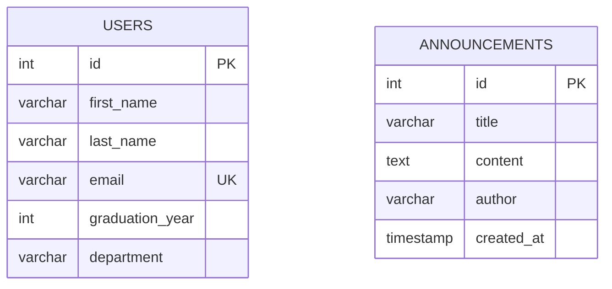
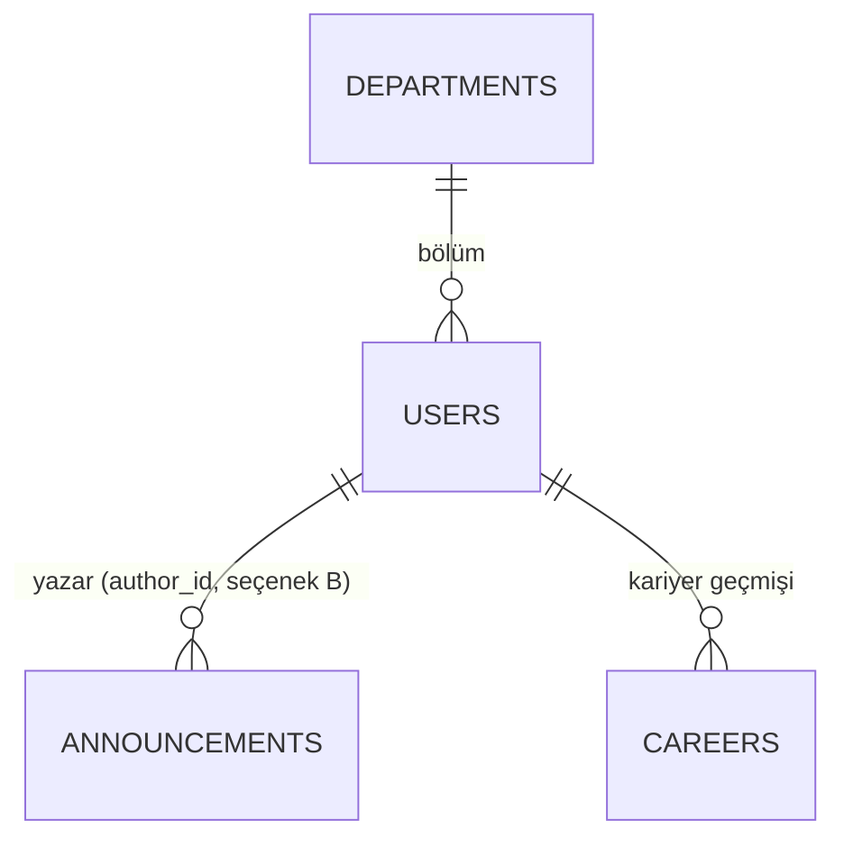

# Data Design Documentation (DDD)

> **Durum:** Yalnızca tasarım aşaması. Veritabanı **henüz oluşturulmamıştır**; uygulama hâlâ bellek içi (`_db`) depolama kullanır.
> Bu doküman, [README.md](README.md) içindeki "Planned" PostgreSQL + SQLAlchemy geçişinin veri tasarımıdır.

## 1. Amaç ve Kapsam

Alumni Tracking System'in kalıcı veri modelini tanımlamak:

* Hangi varlıklar (entity) var, hangi alanları tutuyor?
* Alan tipleri, kısıtlar (constraint), indeksler
* Varlıklar arası ilişkiler
* Mevcut Pydantic şemaları ile eşleşme

**Neden gerekli?** Mevcut veri `User._db` ve `Announcement._db` listelerinde tutuluyor. Konteyner yeniden başlayınca veri kayboluyor (unutma testi başarısız oldu). Kalıcılık için ilişkisel veritabanı tasarımı gerekiyor.

## 2. Teknoloji Kararları

| Konu | Karar |
| :--- | :--- |
| DBMS | PostgreSQL |
| ORM | SQLAlchemy |
| Birincil anahtar | `INTEGER` auto-increment (`SERIAL` / identity). Mevcut `_auto_increment_id` mantığıyla uyumlu |
| Zaman damgası | `TIMESTAMP` (UTC) |
| İsimlendirme | `snake_case`, tablo adları çoğul |

## 3. Varlıklar (Entities)

Mevcut kodda iki varlık vardır: **User** (mezun) ve **Announcement** (duyuru).

### 3.1 `users` tablosu

Kaynak: [models/user.py](models/user.py) (`UserCreate`, `UserUpdate`, `UserPatch`)

| Kolon | Tip | Kısıt | Açıklama |
| :--- | :--- | :--- | :--- |
| `id` | `INTEGER` | **PK**, auto-increment | Mezun kimliği |
| `first_name` | `VARCHAR(100)` | `NOT NULL` | Ad |
| `last_name` | `VARCHAR(100)` | `NOT NULL` | Soyad |
| `email` | `VARCHAR(255)` | `NOT NULL`, **`UNIQUE`** | E-posta. Modelde `get_by_email` küçük harfe çevirip karşılaştırıyor, bu yüzden küçük harfle saklanmalı |
| `graduation_year` | `INTEGER` | `NOT NULL`, `CHECK (graduation_year BETWEEN 1900 AND 2100)` | Mezuniyet yılı |
| `department` | `VARCHAR(150)` | `NOT NULL` | Bölüm |

**İndeksler**

| İndeks | Kolon | Neden |
| :--- | :--- | :--- |
| `pk_users` | `id` | Birincil anahtar |
| `uq_users_email` | `email` | Tekil e-posta, e-posta ile arama |
| `ix_users_department` | `department` | Bölüme göre filtreleme |
| `ix_users_graduation_year` | `graduation_year` | Yıla göre filtreleme |

### 3.2 `announcements` tablosu

Kaynak: [models/announcement.py](models/announcement.py)

| Kolon | Tip | Kısıt | Açıklama |
| :--- | :--- | :--- | :--- |
| `id` | `INTEGER` | **PK**, auto-increment | Duyuru kimliği |
| `title` | `VARCHAR(200)` | `NOT NULL` | Başlık |
| `content` | `TEXT` | `NOT NULL` | İçerik |
| `author` | `VARCHAR(150)` | `NOT NULL` | Yazar adı (serbest metin, bkz. 5. bölüm) |
| `created_at` | `TIMESTAMP` | `NOT NULL`, `DEFAULT now()` | Oluşturulma zamanı (kodda otomatik atanıyor) |

**İndeksler**

| İndeks | Kolon | Neden |
| :--- | :--- | :--- |
| `pk_announcements` | `id` | Birincil anahtar |
| `ix_announcements_created_at` | `created_at DESC` | En yeni duyuruları listeleme |

## 4. ER Diyagramı

Şu an iki tablo arasında **veritabanı seviyesinde ilişki yoktur**. Gerekçe 5. bölümde.

## 5. İlişkiler ve Açık Tasarım Kararları

| # | Konu | Mevcut durum | Seçenek | Öneri |
| :--- | :--- | :--- | :--- | :--- |
| 1 | `announcements.author` | Serbest metin | **A)** Metin olarak kalsın. **B)** `author_id` ile `users.id` FK olsun | **A** ile başla. Mevcut API ve formlar `author` metni alıyor. Yazar mezun olmayabilir (ör. yönetici) |
| 2 | Kullanıcı rolleri (admin/mezun) | Yok | `role` kolonu veya ayrı `roles` tablosu | Kapsam dışı. Gerekirse sonra eklenir |
| 3 | Mezun kariyer bilgisi | Yok (README amaç olarak belirtiyor) | `careers` tablosu (şirket, pozisyon, tarih), `users` ile 1-N | Sonraki aşama için aday |
| 4 | `department` | Serbest metin | Ayrı `departments` tablosu ve FK | Tutarlılık için ileride düşünülebilir. Şimdilik metin |
| 5 | Silme davranışı | Kayıt silinir | Soft delete (`deleted_at`) | Şimdilik hard delete (mevcut `delete` davranışı) |

> [!NOTE]
> 1, 3 ve 4 numaralı kararlar hocayla netleştirilecek. Seçenek B veya ayrı tablolar seçilirse ER diyagramı güncellenecek.

### Olası genişletilmiş model (henüz uygulanmayacak)

## 6. Pydantic Şeması ve Tablo Eşleşmesi

| Pydantic şeması | Tablo | Not |
| :--- | :--- | :--- |
| `UserCreate` | `users` | `id` gönderilmez, DB üretir |
| `UserUpdate` (PUT) | `users` | Tüm alanlar zorunlu |
| `UserPatch` (PATCH) | `users` | Tüm alanlar opsiyonel |
| `AnnouncementCreate` | `announcements` | `id` ve `created_at` DB/uygulama üretir |
| `AnnouncementUpdate` (PUT) | `announcements` | `created_at` değişmez |
| `AnnouncementPatch` (PATCH) | `announcements` | Tüm alanlar opsiyonel |

## 7. CRUD'un SQL Karşılığı (Taslak)

| İşlem | Mevcut model fonksiyonu | SQL |
| :--- | :--- | :--- |
| Create | `User.create` | `INSERT INTO users (...) VALUES (...) RETURNING *` |
| Read all | `User.get_all` | `SELECT * FROM users` |
| Read by id | `User.get_by_id` | `SELECT * FROM users WHERE id = :id` |
| Read by email | `User.get_by_email` | `SELECT * FROM users WHERE email = lower(:email)` |
| Update (PUT) | `User.update` | `UPDATE users SET ... WHERE id = :id` |
| Patch | `User.patch` | `UPDATE users SET <yalnızca gelen alanlar> WHERE id = :id` |
| Delete | `User.delete` | `DELETE FROM users WHERE id = :id` |

`announcements` için aynı kalıp geçerlidir. Bulunamayan `id` için `0 satır` etkilenir, controller bunu **404**'e çevirir (mevcut davranış).

## 8. Kalıcılık Planı (Uygulama aşaması için not)

Şimdilik **uygulanmayacak**, sadece planlanıyor:

* `docker-compose.yml` içine `db` (PostgreSQL) servisi ve **named volume** eklenecek. Amaç: "unutma testinin" geçmesi.
* `requirements.txt` içine `sqlalchemy` ve bir PostgreSQL sürücüsü eklenecek.
* Model katmanı bellek içi `_db` yerine SQLAlchemy oturumu kullanacak. Controller'lar aynı kalacak.
* Doğrulama: kayıt oluştur, `docker compose down` ve `up`, kaydı kontrol et.

## 9. Sonraki Adımlar

- [ ] Açık tasarım kararlarını (5. bölüm) hocayla netleştir
- [ ] ER diyagramını son haline getir
- [ ] Veritabanını oluştur (**bu aşamada yapılmıyor**)
- [ ] Modelleri SQLAlchemy'ye taşı
- [ ] Unutma testini tekrar çalıştır
